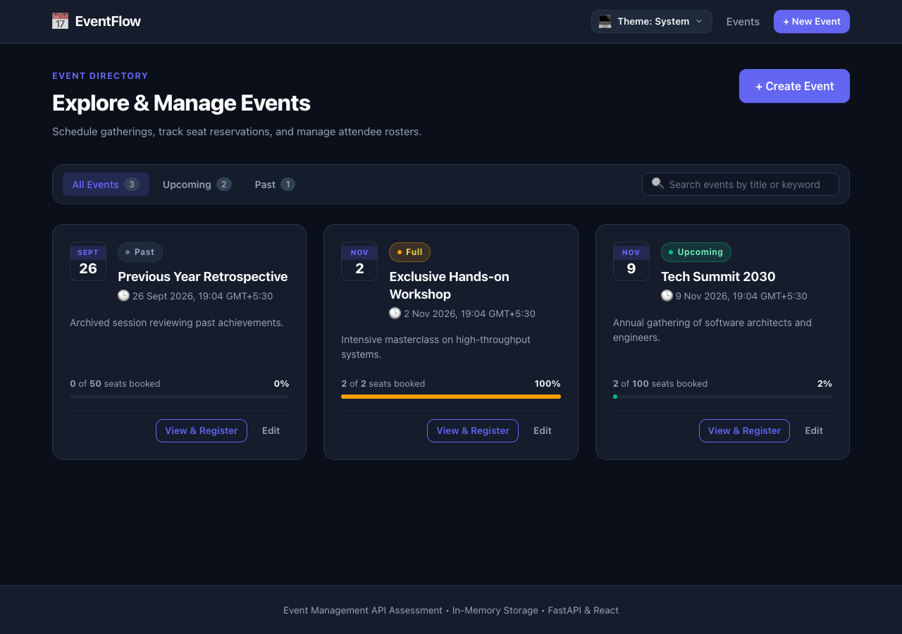
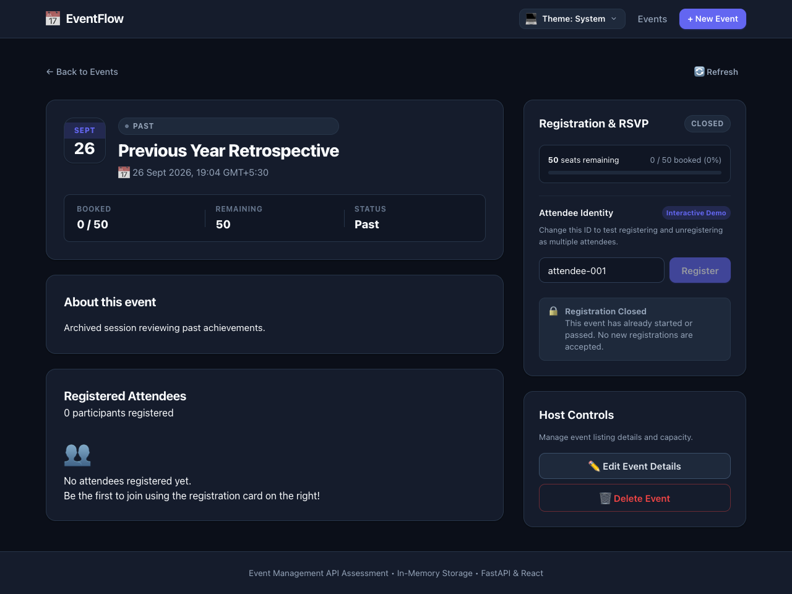
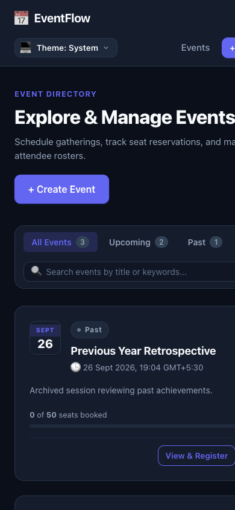
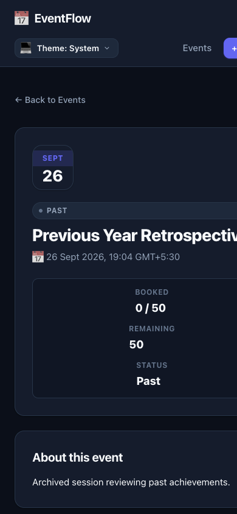
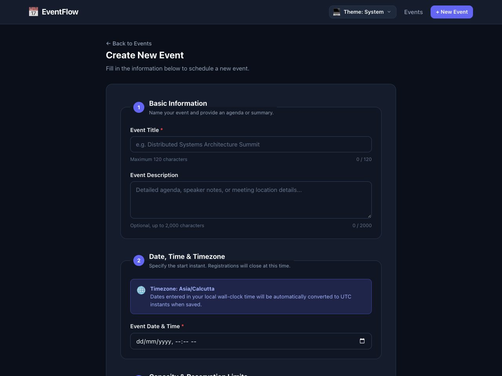

# Event Management Application

A complete, production-grade Event Management application featuring an in-memory Python FastAPI REST API and a React 19 TypeScript Single Page Application built with Vite.

| Desktop Event Directory (Light) | Desktop Event Directory (Dark) |
|---|---|
|  |  |

## Overview

This application fulfills all requirements of the Event Management assessment:
- **Event Lifecycle**: Standard CRUD operations for events (create, read/list, full update, delete).
- **Attendee Registrations**: Atomic registration and unregistration for events.
- **Business Rule Enforcement**:
  - Registration is strictly prohibited for past or started events (`date <= now`).
  - Strict maximum capacity enforcement under thread-safe atomic critical sections (`EVENT_FULL`).
  - Prevention of duplicate registrations for the same user on an event (`ALREADY_REGISTERED`).
  - Rejection of capacity reductions below the current number of registered attendees (`CAPACITY_BELOW_REGISTRATIONS`).
  - Cascading deletion of registrations upon event deletion.
- **In-Memory Storage**: Thread-safe in-memory dictionaries synchronized with a shared `threading.Lock`. All business data resides in Python process memory and resets on restart.
- **Appearance & Dark Mode**: System, Light, and Dark preferences with persistence in `localStorage` under `event-management:theme`. Client-side appearance is decoupled from backend memory. Inline head script prevents flash of unstyled theme (FOUC). Form inputs, selected attendee identities, and modal dialogs remain active across appearance changes.
- **Consistent Error Contract**: Standardized JSON error envelope for all failures (400, 404, 409, 422, 500).
- **Timezone Awareness**: Full UTC normalization on backend with browser timezone conversion in frontend. Editing an event preserves untouched date instants without seconds truncation.
- **Modern Accessible UI (Mobbin Patterns)**: Inspired by patterns from Luma, Eventbrite, Partiful, and Circle, including calendar date tiles, capacity gauges, occupancy indicators, category filtering, avatar attendee rosters, and interactive demo identity controls. See [docs/ui-design.md](docs/ui-design.md) and [DESIGN.md](DESIGN.md).

## Interface Screenshots

| Desktop Event Detail (Light) | Desktop Event Detail (Dark) |
|---|---|
|  |  |

| Mobile Directory (Light & Dark) | Mobile Detail (Light & Dark) |
|---|---|
|   |   |

| Create and Edit Event Form (Light & Dark) |
|---|
|  |
|  |

---

## Agent Readiness and Design System

The repository provides documentation tailored for human contributors and automated coding agents:
- [AGENTS.md](AGENTS.md): Core architectural invariants, concurrency locks, volatile memory rules, environment setup, and change routing.
- [DESIGN.md](DESIGN.md): Visual design system, semantic color tokens, light/dark palettes, WCAG AA contrast measurements, and accessibility standards.
- [.agents/skills/event-management-quality/SKILL.md](.agents/skills/event-management-quality/SKILL.md): Local verification skill for validating business rules, concurrency race conditions, and appearance stability.
- [docs/review-findings.md](docs/review-findings.md): Complete audit log and root cause disposition for issues F01 through F12.
- [docs/scenario-coverage.md](docs/scenario-coverage.md): Comprehensive scenario coverage matrix mapping every edge case to its automated test proof.
- [docs/decisions.md](docs/decisions.md): Architecture Decision Records (ADR-001 through ADR-007).

---

## Tested Runtime Environment

The application was built and validated against the following runtimes:
- **Python**: 3.14.2 (compatible with Python >= 3.12)
- **Node.js**: v22.22.3
- **npm**: 10.9.8
- **OS**: macOS (Apple Silicon arm64)

---

## Architecture & Directory Layout

```text
event-management/
├── AGENTS.md                           # Autonomous coding agent guidelines & architectural invariants
├── DESIGN.md                           # Design system, semantic tokens, and dark mode architecture
├── README.md                           # Project documentation & execution guide
├── .github/
│   └── workflows/
│       └── ci.yml                      # CI workflow (Pytest, Ruff, ESLint, Typecheck, Build)
├── .agents/
│   └── skills/
│       └── event-management-quality/   # Local verification and quality audit skill
│           ├── SKILL.md
│           └── scripts/
│               └── verify_quality.sh   # Reusable quality verification runner
├── docs/
│   ├── decisions.md                    # Architecture Decision Records (ADR-001 to ADR-007)
│   ├── demo.md                         # Detailed step-by-step demonstration walkthrough
│   ├── review-findings.md              # Review audit log for F01 to F12
│   ├── scenario-coverage.md            # Evidence-backed scenario coverage matrix
│   ├── ui-design.md                    # Mobbin design research, patterns, and decisions
│   └── screenshots/                    # Desktop & mobile captures in Light and Dark appearances
├── backend/
│   ├── pyproject.toml                  # Backend project metadata & tool configs
│   ├── requirements.txt                # Pinned production runtime dependencies
│   ├── requirements-dev.txt            # Pinned development and testing dependencies
│   ├── app/
│   │   ├── main.py                     # FastAPI app factory, CORS, exception handlers
│   │   ├── models.py                   # Frozen dataclass domain entities
│   │   ├── schemas.py                  # Pydantic v2 validation contracts & response schemas
│   │   ├── errors.py                   # Domain exceptions & error codes
│   │   ├── store.py                    # Thread-safe in-memory store
│   │   ├── service.py                  # Atomic business logic & clock integration
│   │   ├── seed.py                     # Startup demo data seeder (relative dates)
│   │   └── api/
│   │       └── events.py               # REST route handlers
│   └── tests/
│       ├── conftest.py                 # Pytest fixtures (fresh store, fake clock, TestClient)
│       ├── test_health.py              # Health check & app isolation tests
│       ├── test_service.py             # Business rule unit tests & schema validation tests
│       ├── test_concurrency.py         # Thread barrier concurrency & race condition tests
│       └── test_api.py                 # HTTP contract & status code tests
└── frontend/
    ├── package.json                    # Scripts and dependencies (React 19, Vite, Vitest)
    ├── vite.config.ts                  # Vite & Vitest configuration
    ├── tsconfig.json                   # TypeScript configuration
    ├── eslint.config.js                # ESLint flat config
    ├── index.html                      # HTML entrypoint with inline appearance bootstrap
    └── src/
        ├── api/
        │   ├── client.ts               # Resilient fetch client with error normalization
        │   └── types.ts                # TypeScript interfaces matching backend contracts
        ├── components/
        │   ├── EventForm.tsx           # Create / Edit event form with timezone handling
        │   ├── EventForm.test.tsx      # Event form component unit tests
        │   └── AttendeeControls.tsx    # Demo attendee registration controls
        ├── pages/
        │   ├── EventListPage.tsx       # Event directory with status badges and actions
        │   ├── EventDetailPage.tsx     # Details, attendee roster, and action controls
        │   ├── EventDetailPage.test.tsx# Event detail component unit tests
        │   └── EventFormPage.tsx       # Routed create / edit container
        ├── utils/
        │   ├── avatar.ts               # Deterministic attendee avatar generation
        │   ├── date.ts                 # Timezone-aware date parsing and conversion utilities
        │   ├── theme.ts                # Theme preference, resolution, and useTheme hook
        │   └── theme.test.ts           # Theme utility unit tests
        ├── App.tsx                     # React Router routes, shell, and theme selector
        ├── App.test.tsx                # App integration & theme state tests
        ├── main.tsx                    # React DOM entrypoint
        └── styles.css                  # Semantic tokens for Light and Dark themes
```

---

## Quick Start (Two Terminals)

### Terminal 1: Backend API

1. Navigate to the backend directory:
   ```bash
   cd backend
   ```
2. Create and activate a virtual environment:
   ```bash
   python3 -m venv .venv
   source .venv/bin/activate
   ```
3. Install dependencies:
   ```bash
   pip install -r requirements-dev.txt
   ```
4. Start the Uvicorn server:
   ```bash
   python -m uvicorn app.main:app --host 127.0.0.1 --port 8000 --workers 1
   ```
   > **Note on Storage & Concurrency**: Always run with `--workers 1`. The application state resides entirely in the Python process memory. Using multiple worker processes would isolate memory across workers.
   >
   > To start with sample demo events pre-seeded (using startup-relative dates), set `SEED_DEMO_DATA=true`:
   > ```bash
   > SEED_DEMO_DATA=true python -m uvicorn app.main:app --host 127.0.0.1 --port 8000 --workers 1
   > ```

Development URLs:
- **API Root**: `http://127.0.0.1:8000`
- **Interactive Swagger Docs**: `http://127.0.0.1:8000/docs`
- **OpenAPI Schema**: `http://127.0.0.1:8000/openapi.json`
- **Health Check**: `http://127.0.0.1:8000/health`

### Terminal 2: Frontend Web Application

1. Navigate to the frontend directory:
   ```bash
   cd frontend
   ```
2. Install dependencies:
   ```bash
   npm ci
   ```
3. Start the Vite development server:
   ```bash
   npm run dev -- --host 127.0.0.1
   ```

Open `http://127.0.0.1:5173` in your browser.

---

## Reusable Quality Verification

To run the complete quality and regression test suite across backend and frontend in a single step:
```bash
./.agents/skills/event-management-quality/scripts/verify_quality.sh
```

### Backend Verification
From `backend/` with virtual environment activated:
```bash
# Run unit, API contracts, edge validations, and barrier concurrency tests (68 tests)
pytest -v

# Run with demo seeding explicitly active to verify fixture isolation
SEED_DEMO_DATA=true pytest -q

# Run Ruff linter check
ruff check .

# Run Ruff code formatter check
ruff format --check .
```

### Frontend Verification
From `frontend/`:
```bash
# Run Vitest component, theme, and date tests (52 tests across 7 test suites)
npm test

# Run TypeScript typecheck
npm run typecheck

# Run ESLint check
npm run lint

# Run production build
npm run build
```

---

## REST API Specification

### Endpoints

| Method | Path | Description | Success | Common Failure Codes |
|---|---|---|---|---|
| `GET` | `/health` | Service health status | `200 OK` | - |
| `GET` | `/api/events` | List all events (sorted by date, id) | `200 OK` | `500 INTERNAL_ERROR` |
| `POST` | `/api/events` | Create a new event | `201 Created` (`Location`) | `400 INVALID_JSON`, `422 VALIDATION_ERROR` |
| `GET` | `/api/events/{id}` | Get event details by ID | `200 OK` | `404 EVENT_NOT_FOUND`, `422 VALIDATION_ERROR` |
| `PUT` | `/api/events/{id}` | Replace all writable event fields | `200 OK` | `404`, `409 CAPACITY_BELOW_REGISTRATIONS`, `422` |
| `DELETE` | `/api/events/{id}` | Delete event and its registrations | `204 No Content` | `404 EVENT_NOT_FOUND`, `422 VALIDATION_ERROR` |
| `GET` | `/api/events/{id}/registrations` | List attendees registered for event | `200 OK` | `404 EVENT_NOT_FOUND`, `422 VALIDATION_ERROR` |
| `POST` | `/api/events/{id}/registrations` | Register attendee (`userId`) | `201 Created` (`Location`) | `404`, `409 EVENT_STARTED`, `409 ALREADY_REGISTERED`, `409 EVENT_FULL` |
| `DELETE` | `/api/events/{id}/registrations/{userId}` | Unregister attendee | `204 No Content` | `404 EVENT_NOT_FOUND`, `422 VALIDATION_ERROR` |

---

## Example cURL Commands

### 1. Health Check
```bash
curl -s http://127.0.0.1:8000/health
```

### 2. Create an Event
```bash
curl -i -X POST http://127.0.0.1:8000/api/events \
  -H "Content-Type: application/json" \
  -d '{
    "title": "Cloud Architecture Summit 2030",
    "description": "Deep dive into event-driven systems and microservices.",
    "date": "2030-06-15T13:00:00Z",
    "maxCapacity": 2
  }'
```

### 3. List Events
```bash
curl -s http://127.0.0.1:8000/api/events
```

### 4. Register an Attendee
```bash
curl -i -X POST http://127.0.0.1:8000/api/events/{eventId}/registrations \
  -H "Content-Type: application/json" \
  -d '{"userId": "attendee-001"}'
```

### 5. Attempt Duplicate Registration (Observe 409 Conflict)
```bash
curl -i -X POST http://127.0.0.1:8000/api/events/{eventId}/registrations \
  -H "Content-Type: application/json" \
  -d '{"userId": "attendee-001"}'
```

### 6. Fill Capacity and Attempt Overbooking (Observe 409 Conflict)
```bash
# Register second attendee to reach capacity (maxCapacity was 2)
curl -i -X POST http://127.0.0.1:8000/api/events/{eventId}/registrations \
  -H "Content-Type: application/json" \
  -d '{"userId": "attendee-002"}'

# Attempt third attendee
curl -i -X POST http://127.0.0.1:8000/api/events/{eventId}/registrations \
  -H "Content-Type: application/json" \
  -d '{"userId": "attendee-003"}'
```

### 7. Unregister an Attendee
```bash
curl -i -X DELETE http://127.0.0.1:8000/api/events/{eventId}/registrations/attendee-001
```

### 8. Update Event (Full PUT)
```bash
curl -i -X PUT http://127.0.0.1:8000/api/events/{eventId} \
  -H "Content-Type: application/json" \
  -d '{
    "title": "Cloud Architecture Summit 2030 (Updated)",
    "description": "Expanded venue with additional breakout sessions.",
    "date": "2030-06-16T10:00:00Z",
    "maxCapacity": 50
  }'
```

### 9. Delete Event
```bash
curl -i -X DELETE http://127.0.0.1:8000/api/events/{eventId}
```

---

## Design Assumptions & Known Limitations

1. **In-Memory Volatility**: All event and registration data is stored in Python heap memory dictionaries. Restarting or reloading the server process resets all data.
2. **Single-Worker Execution**: Because state is kept in memory, the backend must run on a single worker process (`--workers 1`). Multi-worker deployments would create isolated memory partitions.
3. **Storage Separation**: UI appearance preference persists in client `localStorage` under `event-management:theme` for user convenience. Event and registration data remains strictly in backend memory and is never persisted to disk.
4. **Identity & Authentication**: Authentication and authorization are out of scope. The caller supplies an alphanumeric `userId` string (`1-64` characters `[A-Za-z0-9_-]`). The UI provides a Demo Attendee ID switcher to test multi-user scenarios.
5. **Collection Pagination**: Events and registrations are unpaginated for this exercise. For large production deployments, cursor-based pagination and database indexing would be used.
6. **Event Start Time**: Event `date` represents the start time instant. New registrations close once `date <= now`. Existing attendees may still unregister after the start time.
